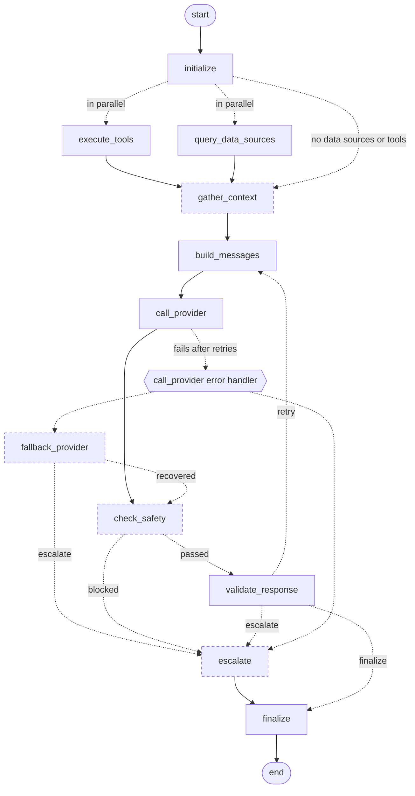

<!-- Generated by scripts/export_workflow_diagrams.py - do not edit by hand -->
# ThinkLife Brain workflow v1.1.0

Generated from `brain/cortex/workflow_engine.py`. Solid arrows always run; dotted arrows are conditional routes, labelled with the route name. Dashed boxes are the nodes added in US 1.1. See [README.md](README.md) for what each node does and the failure table.

